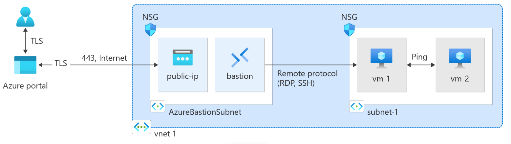
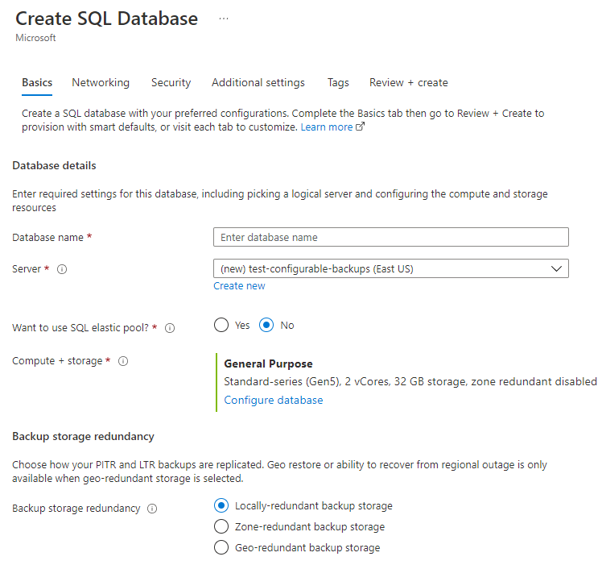

# ☁️ Laboratório DIO: Tipos de Serviço de Nuvem e Banco de Dados no Microsoft Azure

Este repositório documenta os conceitos arquiteturais e práticos explorados no laboratório da trilha **Microsoft Azure Fundamentals (AZ-900)** da **DIO (Digital Innovation One)**, abrangendo a infraestrutura de Máquinas Virtuais (IaaS), redes, segurança e o provisionamento de Bancos de Dados na nuvem (PaaS).

## 🎯 Objetivos de Aprendizagem

* Compreender os modelos de serviço em nuvem (**IaaS, PaaS e SaaS**) e suas responsabilidades de gerenciamento.
* Analisar a arquitetura de uma **Máquina Virtual (VM)** no Azure, incluindo discos de armazenamento, redes virtuais, exposição pública e proteção.
* Praticar a configuração de uma instância de **Banco de Dados no Azure** (Azure SQL / SQL Managed Instance), definindo localização, redundância de backup e estimativa de custos.
* Documentar processos técnicos de forma estruturada no GitHub como material de apoio.

---

## 🏗️ 1. Arquitetura de Máquinas Virtuais (IaaS)

No modelo de **Infraestrutura como Serviço (IaaS)**, o Azure fornece os recursos computacionais virtualizados, enquanto o usuário gerencia o sistema operacional e as aplicações. Durante o laboratório, foram analisados os seguintes pilares de uma VM:

* **Armazenamento (Discos):**
  * **Disco do Sistema Operacional (OS Disk):** Onde fica instalado o Windows ou Linux.
  * **Disco Temporário:** Fornece armazenamento de curta duração para arquivos de paginação e swap (dados perdidos em caso de realocação).
  * **Discos de Dados (Data Disks):** Discos gerenciados (HDD Standard, SSD Standard, SSD Premium ou Ultra Disk) anexados para persistência de dados da aplicação.
* **Tipos de Rede e Conectividade:**
  * **VNet (Virtual Network) e Subnets:** Isolamento lógico da rede privada onde a VM reside.
  * **NIC (Network Interface Card):** Placa de rede virtual que conecta a VM à VNet e atribui um **IP Privado**.
* **Exposição (Acesso Externo):**
  * **IP Público:** Permite comunicação direta com a internet (quando necessário).
  * **NSG (Network Security Group):** Atua como um firewall básico filtrando o tráfego de entrada e saída por portas e protocolos (ex.: libera porta `3389` para RDP no Windows, `22` para SSH no Linux, ou `80/443` para tráfego Web).
* **Gerenciamento de Proteção:**
  * Implementação de **Azure Backup** (cofres de serviços de recuperação), atualizações automáticas do sistema operacional e integração com o **Microsoft Defender for Cloud** para monitoramento de postura de segurança.

---

## 🗄️ 2. Configuração de Banco de Dados no Azure (PaaS)

No modelo de **Plataforma como Serviço (PaaS)** — como o **Azure SQL Database** ou **Azure SQL Managed Instance** — a Microsoft gerencia o hardware, o sistema operacional e o mecanismo do banco de dados (patches e atualizações), permitindo foco total nos dados.

### Etapas de Criação e Configuração Analisadas:

1. **Criação e Grupos de Recursos:**
   * Organização dos recursos dentro de uma **Subscription** e um **Resource Group** dedicado para facilitar o controle e a exclusão posterior.
   * Definição do servidor lógico, credenciais de autenticação (Autenticação SQL e/ou Microsoft Entra ID) e regras de firewall de rede.
2. **Localização (Região):**
   * Escolha estratégica da **Região do Azure** (ex.: *Brazil South*, *East US*) considerando três fatores críticos:
     * **Latência:** Proximidade geográfica com os usuários e aplicações que consomem o banco.
     * **Conformidade e Soberania de Dados:** Leis locais (como a LGPD) que exigem que os dados permaneçam em território nacional.
     * **Disponibilidade e Preço:** Variação de custos e recursos disponíveis entre diferentes regiões.
3. **Modelo de Redundância de Armazenamento de Backup:**
   * Configuração de como os backups automatizados do banco de dados são replicados para garantir recuperação em caso de falhas:
     * **LRS (Redundância Local):** Backups armazenados localmente em um único datacenter.
     * **ZRS (Redundância de Zona):** Backups replicados entre 3 Zonas de Disponibilidade na mesma região.
     * **RA-GRS (Redundância Geográfica com Acesso de Leitura):** Padrão recomendado para produção, replicando backups para uma região secundária emparelhada para recuperação de desastres (*Geo-Restore*).
4. **Apresentação e Estimativa de Custos:**
   * Análise do painel de **Resumo de Custos Estimados** antes da criação final, avaliando o impacto da escolha entre os modelos de compra:
     * **Modelo baseado em DTU (Database Transaction Unit):** Pacote pré-configurado de computação, armazenamento e I/O (ideal para simplicidade e previsibilidade).
     * **Modelo baseado em vCore:** Escolha granular de núcleos virtuais, memória e armazenamento, permitindo escalabilidade independente e economia com o *Azure Hybrid Benefit*.
     * **Camada Serverless:** Escala automaticamente a computação sob demanda e pausa o banco durante períodos de inatividade, cobrando apenas pelo armazenamento utilizado.

---

## 🛠️ Resumo Prático do Laboratório

1. **Mapeamento de Arquitetura IaaS:** Revisão dos componentes obrigatórios e opcionais no provisionamento de uma VM (Compute, Networking, Disks e Management).
2. **Provisionamento de Banco de Dados:** Simulação da criação de uma instância SQL no Portal do Azure, validando configurações de rede, redundância de backup e impacto financeiro no painel de custos.
3. **Boas Práticas de Governança:** Adoção de nomenclaturas padronizadas, tags de identificação e monitoramento de custos via **Azure Cost Management**.

### Arquitetura de Rede e Proteção (NSG/IP)

### Redundância de Backup e Custos do Banco de Dados

## 📸 *Fonte: [Documentação Oficial do Microsoft Azure](https://learn.microsoft.com/pt-br/azure/)*

## 📚 Referências Oficiais

* [Início Rápido: Criar uma Instância Gerenciada de SQL do Azure (Microsoft Learn)](https://learn.microsoft.com/pt-br/azure/azure-sql/managed-instance/instance-create-quickstart)
* [Documentação do Banco de Dados SQL do Azure](https://learn.microsoft.com/pt-br/azure/azure-sql/database/)

## 🚀 Conclusão

O laboratório consolidou na prática a diferença de gerenciamento entre **IaaS** (controle total sobre VM, discos e rede) e **PaaS** (agilidade no provisionamento de bancos de dados gerenciados), destacando como decisões de **localização, redundância e dimensionamento (DTU/vCore)** impactam diretamente a resiliência e os custos na nuvem.
